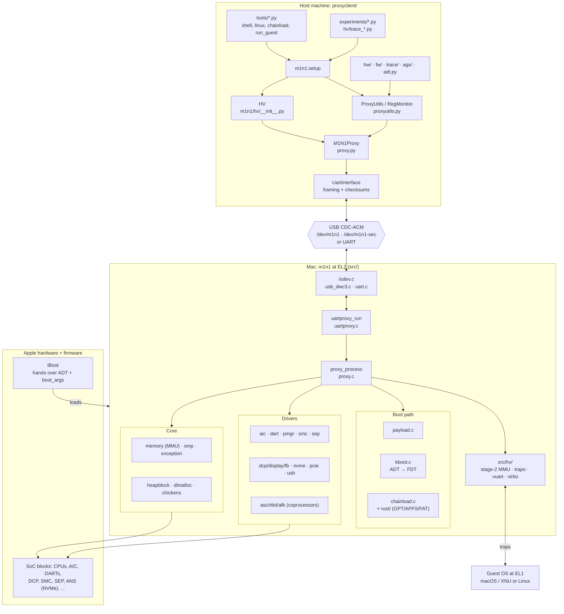
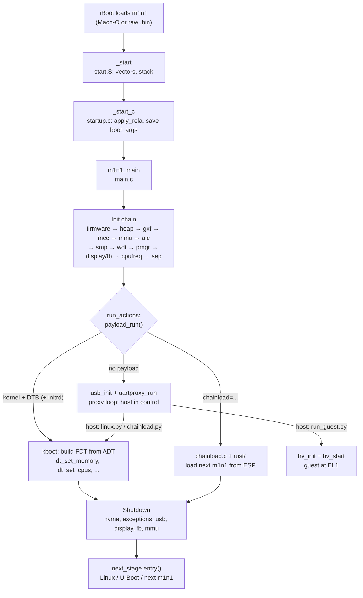
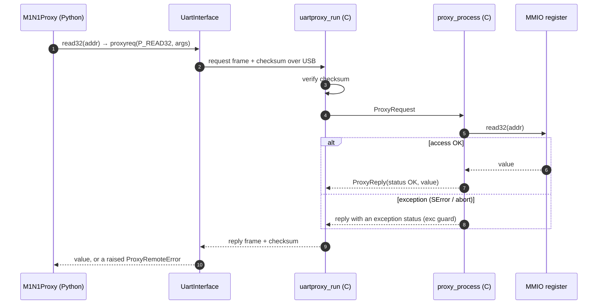
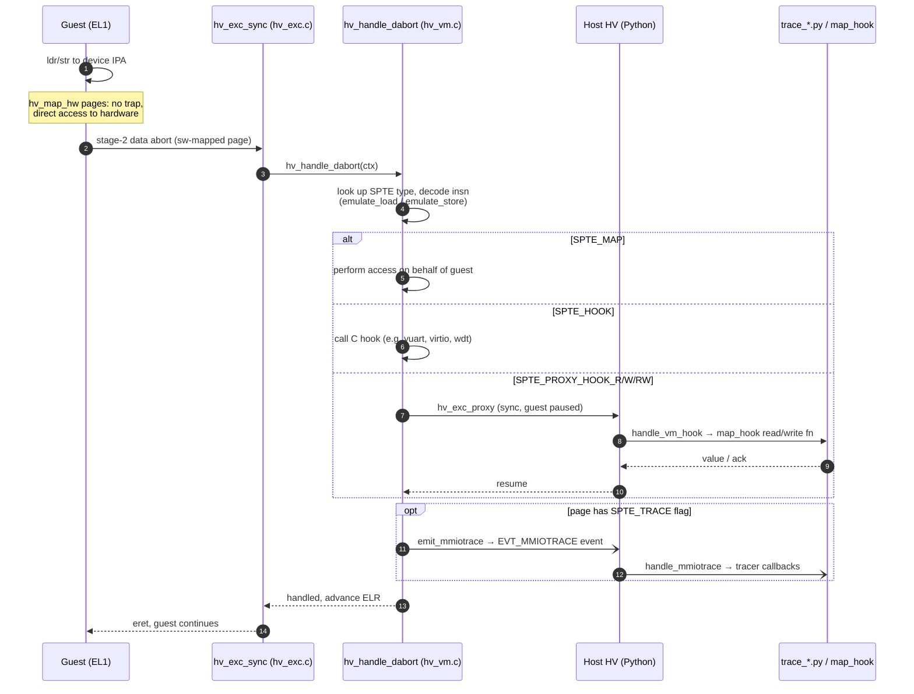

# m1n1 Starter Guide

A map of the m1n1 codebase for someone new to it: what it is, how it's laid out, how control flows
from power-on to the next stage, and how the Python side talks to it.

> Personal study notes. Not part of upstream. Upstream m1n1 does not accept AI/LLM-assisted
> contributions (see https://asahilinux.org/slop/). Write anything you send upstream yourself.

---

## 1. What m1n1 is

m1n1 is the Asahi Linux bootloader for Apple Silicon Macs. It also works as a **hardware
experimentation playground**. It has three jobs:

1. **Bootloader.** Apple's iBoot loads m1n1 as if it were a macOS kernel (a Mach-O, or a raw binary
   for macOS ≥ 12.1). m1n1 sets up the hardware, converts Apple's device tree (the **ADT**) into a
   Linux **FDT**, and then jumps to the next stage. That next stage is Linux, U-Boot, or another m1n1.
2. **Proxy.** If m1n1 finds no payload, it runs a small RPC server over USB or UART. A Python
   client on a host machine (`proxyclient/`) can then read and write memory and MMIO, call code, run
   on other CPUs, boot kernels, and so on. Most Asahi reverse engineering is done this way.
3. **Hypervisor.** m1n1 can run macOS (or Linux) as a guest at EL1 while it stays at EL2. From
   there it traps and logs MMIO accesses so you can watch how Apple's drivers talk to the hardware.

**Stage 1 vs stage 2.** The Asahi installer puts a *stage 1* m1n1 into the boot policy. Stage 1 is
built with `CHAINLOADING=1` and changes rarely. It loads a *stage 2* m1n1 from the EFI system
partition, and stage 2 carries the payloads (DTBs, U-Boot). Users can then upgrade m1n1 without
re-running `kmutil`.

License: GPL-2.0-or-later from v2.0.0 on (code from before 1.9.9 is MIT). See `README.md`.

---

## Architecture at a glance

> Diagrams use Mermaid. View them in GitHub, VS Code's Markdown preview, or Obsidian.

### A. System architecture
The host side (Python) and the target side (m1n1 at EL2 on the Mac) talk over USB serial or a UART.
Everything the host does goes through `proxy_process` on the target.



### B. Boot flow
This shows what happens between iBoot and the next stage. The detailed init list is in §4.



### C. Life of one proxy request
Example: `p.read32(addr)` from the shell.



### D. Hypervisor: how a guest MMIO access is handled
The guest page tables at stage 2 decide whether an access goes straight to the hardware or is
emulated in C, and whether the host sees it in Python.



---

## 2. Repository map

| Path | What lives there |
|---|---|
| `src/` | The firmware itself: freestanding C and AArch64 assembly. Most files are one driver or subsystem each. |
| `src/hv/` | Hypervisor: stage-2 page tables, exception handling, vUART, virtio, SPRR/SPTM emulation, and watchdog. |
| `src/chickens/` | Per-CPU-core init ("chicken bits": errata and tuning) for each Apple core generation (firestorm/icestorm = M1, avalanche/blizzard = M2, everest/sawtooth = M3, and so on). |
| `src/dcp/` | The DCP (display coprocessor) endpoint protocols used for DisplayPort and HDMI bring-up. |
| `src/libfdt`, `src/dlmalloc`, `src/minilzlib`, `src/tinf`, `src/math` | Vendored libraries: FDT manipulation, malloc, xz and gzip decompression, and float math. |
| `sysinc/` | A minimal libc-style header set (the build uses `-nostdinc`). |
| `rust/` | A `no_std` Rust staticlib (`librust.a`) linked into m1n1: chainload, GPT/APFS/FAT readers, an ADT helper, NVMe, USB4, and GPU initdata. |
| `config.h` | Compile-time feature knobs (see §3). |
| `m1n1.ld`, `m1n1-raw.ld` | Linker scripts for the Mach-O and raw builds. |
| `data/`, `font/`, `artwork/` | Boot logos (converted to `.bin` by `data/makelogo.sh`) and the console fonts. |
| `proxyclient/m1n1/` | The Python library for driving a device running the m1n1 proxy. |
| `proxyclient/tools/` | Command-line entry points: `shell.py`, `linux.py`, `chainload.py`, `run_guest.py`, … |
| `proxyclient/experiments/` | One-off reverse-engineering scripts (AGX, DCP, SMC, AOP, ISP, …). They are good reading material. |
| `proxyclient/hv/` | Hypervisor tracer scripts (`trace_*.py`), loaded with `run_guest.py -m`. |
| `tools/` | Register-definition generators (JSON ↔ C headers ↔ Python classes). |
| `tests/python/` | Pytest tests for proxyclient helpers (asm, toolchain, loadobjs). |
| `udev/80-m1n1.rules` | A Linux udev rule that creates `/dev/m1n1` and `/dev/m1n1-sec` symlinks for the USB proxy. |
| `Dockerfile`, `docker-compose.yml` | A containerised build environment. |

---

## 3. Building

### Toolchains
- **C:** either `aarch64-linux-gnu-gcc` (the default prefix on x86 hosts) or clang + lld.
  On macOS the `Makefile` sets `USE_CLANG=1` automatically. It finds `llvm-config` (or Homebrew's
  `llvm`) and `ld.lld` (or Homebrew's `lld`). On an arm64 Linux host, use `make ARCH=`.
- **Rust:** `rustup target add aarch64-unknown-none-softfloat`. The Makefile sets
  `RUSTC_BOOTSTRAP=1` because the crate uses `alloc` in `no_std`.
- Clone with `--recursive`.

```sh
make            # → build/m1n1.macho and build/m1n1.bin
make V=1        # verbose
make RELEASE=1  # FB_SILENT_MODE (and EARLY_PROXY_TIMEOUT when chainloading)
make CHAINLOADING=1   # stage-1 style build with the Rust chainload/FAT support
make format / format-check / rustfmt / rustfmt-check
```

### Build details worth knowing
- C code is compiled `-ffreestanding -nostdinc -fpic -mstrict-align -march=armv8.2-a` and, for most
  files, **`-mgeneral-regs-only`**, which means no FP/SIMD registers. A few files that genuinely need
  floating point (`kboot_gpu.c`, `src/math/*`) are listed in `FP_OBJECTS` and built without that
  flag. A new file that needs floats goes there.
- Warnings that are errors include implicit function declarations, implicit int, and strict
  prototypes. `-Wunused-parameter` is on, which explains the `__always_unused`/`__maybe_unused`
  annotations (from `src/types.h`) that appear in recent commits.
- `build/build_cfg.h` and `build/build_tag.h` are generated (by the Makefile and `version.sh`).
- The final ELF is a PIE. `src/startup.c:apply_rela` relocates it at runtime, because iBoot can load
  it anywhere.

### `config.h` knobs
| Define | Effect |
|---|---|
| `USE_FB` | Framebuffer console and boot logo (on by default). |
| `FB_SILENT_MODE` | Keep the fb console off unless verbose boot is set. |
| `EARLY_PROXY_TIMEOUT n` | Bring USB up early and break into the proxy if the host connects within *n* seconds. |
| `BRINGUP` | Minimal build: skips MMU, AIC, SMP, USB, display, … for new SoCs. |
| `NO_DISPLAY` | Skip display configuration on desktop machines. |
| `RTKIT_SYSLOG` | Print coprocessor firmware syslogs to the console. |
| `TARGET` / `TARGET_BOARD` | Device-specific debug builds (for example a different debug UART). |
| `USE_DEBUG_USB` | Switch the DFU USB-C port to debug USB. |

### Installing (from the README)
```sh
# macOS ≥ 12.1 OS container, from 1TR / recovery:
kmutil configure-boot -c m1n1.bin --raw --entry-point 2048 --lowest-virtual-address 0 -v <volume>
```
Payloads are appended by plain concatenation:
```sh
cat build/m1n1.bin Image.gz build/dtb/apple-j274.dtb initramfs.cpio.gz > m1n1-payload.bin
```

---

## 4. Boot flow, step by step

```
iBoot ──► _start (src/start.S)
            │  vector table at .init, early debug_putc('m','1',…) on the UART
            ▼
          _start_c (src/startup.c)
            │  apply_rela() self-relocation, PAN fixup, save boot_args,
            │  dump_boot_args, get_device_info (model/board-id/chip-id from ADT)
            ▼
          m1n1_main (src/main.c)
            │  firmware_init → heapblock_init
            │  usb_enable_debugusb (if SIP allows) → gxf_init → mcc_init
            │  mmu_init → aic_init → smp_init → wdt_disable → pmgr_init
            │  display_init / fb_init / logo → cpufreq_fixup → sep_init
            ▼
          run_actions()
            ├─ payload_run() found something? → it fills `next_stage`
            └─ else: usb_init + uartproxy_run()  (proxy loop; the host drives from here)
            ▼
          shutdown: nvme, exceptions, usb, display, fb, mmu
            ▼
          next_stage.entry(args…)   // Linux / U-Boot / next m1n1
```

Things to notice in `src/main.c`:
- `lp_sip0` (read from `/chosen/asmb` in the ADT) is the boot policy. If "authenticated root" is
  disabled, debug USB is enabled.
- `#ifndef BRINGUP` guards everything that might not work on a brand-new SoC.
- The global `adt` pointer (from `src/adt.h`) is how almost every driver finds its MMIO bases,
  interrupts and tunables. Look nodes up with `adt_path_offset` and read properties with
  `ADT_GETPROP`/`adt_getprop`.
- Secondary CPUs come up in `src/smp.c`. They take the `cpu_reset` path in `start.S` and then call
  `_cpu_reset_c`. Each core runs its chicken-bit init from `src/chickens.c`, which dispatches on the
  MIDR to `src/chickens/*.c`.

---

## 5. Payloads, kboot and chainloading

### `src/payload.c`
After the end of its own image, m1n1 scans memory for concatenated blobs and identifies each one by
its magic number:

| Magic | Meaning |
|---|---|
| `1f 8b` / `fd 37 7a 58 5a 00` | gzip / xz: decompressed in place, then re-scanned |
| `d0 0d fe ed` | FDT (a Linux DTB). m1n1 picks the one whose `compatible` matches the board |
| `ARM\x64` at offset 0x38 | ARM64 kernel `Image` (must be compressed or be the last item) |
| `07070…` | cpio initramfs (must be compressed) |
| `IMG4` | Apple IMG4 container |
| `m1n1_sig` / `m1n1_log…` | signature trailer / custom logo |
| text `key=value` lines | config variables (see `m1n1.conf.example`: `display=`, `chosen.*=`, `mitigations=`, `chainload=`) |

### `src/kboot.c`
This file builds the device tree that Linux receives. It starts from the selected DTB and fills it in
from the ADT and boot args through a series of `dt_set_*` functions: memory map, CPUs, framebuffer,
`/chosen` (bootargs, RNG seed from SEP or ADT), serial number, SMBIOS, MAC addresses, Bluetooth and
Wi-Fi calibration, NVRAM, multitouch, U-Boot config, and more. GPU-specific setup is in
`kboot_gpu.c` (built with FP). Type-C/ATC PHY tunables are in `kboot_atc.c`. The proxy exposes the
same machinery as `P_KBOOT_*`, which is how `proxyclient/tools/linux.py` boots kernels.

### `src/chainload.c` + `rust/src/chainload.rs`
`chainload=<partuuid>;<path>` loads another m1n1 from an APFS or FAT partition. The Rust side
(`gpt.rs`, `apfs.rs`, the FAT support from the `fatfs` crate, `nvme.rs`) finds and reads the file.
The C side relocates it and jumps to it (`chainload_asm.S`). From the host you can do the same thing
interactively with `proxyclient/tools/chainload.py`, which is the fastest m1n1 dev loop: rebuild,
chainload, and never touch `kmutil`.

---

## 6. The proxy: protocol and command set

### Transport (`src/uartproxy.c`, `src/iodev.c`)
- `iodev` abstracts the byte channels: `IODEV_UART`, `IODEV_DOCKCHANNEL_UART`, `IODEV_FB` (output
  only), `IODEV_USB_VUART`, and `IODEV_USB0..7`. USB uses the DWC3 controller in device mode
  (`usb.c`, `usb_dwc3.c`) and presents CDC-ACM serial ports. On Linux these show up as
  `/dev/ttyACM*` (the udev rule links `/dev/m1n1`). On macOS they show up as `/dev/cu.usbmodem*`.
  The second interface (`m1n1-sec`) is a virtual UART that hypervisor guests use.
- `uartproxy_run()` is the request loop: fixed-size request and reply frames with checksums
  (`checksum_block`, `data_checksum`), plus bulk memory transfers. It also sends asynchronous
  *events* (`uartproxy_send_event`). Exceptions taken while serving a request are reported back to
  the host instead of crashing.

### Commands (`src/proxy.h`, dispatched in `src/proxy.c`)
| Range | Group | Examples |
|---|---|---|
| `0x000` | system | `P_CALL`, `P_EL0/1/3_CALL`, `P_GL1/2_CALL`, `P_REBOOT`, `P_GET_BOOTARGS`, `P_GET_CPU_FEATURES` |
| `0x100` | MMIO | `P_READ32`, `P_WRITE64`, `P_SET32`, `P_CLEAR32`, `P_MASK32`, `P_WRITEREAD32` |
| `0x200` | memory | `P_MEMCPY*`, `P_MEMSET*` |
| `0x300` | cache/MMU | `P_DC_CIVAC`, `P_IC_IALLU`, `P_MMU_INIT/SHUTDOWN/DISABLE/RESTORE` |
| `0x400` | decompression | `P_XZDEC`, `P_GZDEC` |
| `0x500` | SMP | `P_SMP_START_SECONDARIES`, `P_SMP_CALL(_SYNC)`, `P_SMP_CALL_EL1/EL0` |
| `0x600` | heap | `P_HEAPBLOCK_ALLOC`, `P_MALLOC`, `P_MEMALIGN`, `P_FREE` |
| `0x700` | kboot | `P_KBOOT_PREPARE_DT`, `P_KBOOT_SET_CHOSEN`, `P_KBOOT_SET_INITRD`, `P_KBOOT_BOOT` |
| `0x800` | power | `P_PMGR_POWER_ENABLE`, `P_PMGR_ADT_POWER_ENABLE`, `P_PMGR_RESET` |
| `0x900` | iodev | `P_IODEV_SET_USAGE`, `P_IODEV_READ/WRITE`, `P_USB_IODEV_VUART_SETUP` |
| `0xa00` | tunables | `P_TUNABLES_APPLY_GLOBAL/LOCAL` |
| `0xb00` | DART | `P_DART_INIT/MAP/UNMAP` |
| `0xc00` | hypervisor | `P_HV_INIT`, `P_HV_MAP`, `P_HV_START`, `P_HV_TRACE_IRQ`, … |
| later | | FB, display, ASC/RTKit, NVMe, PCIe, SMP extras, … (read `proxy.h` to the end) |

**Adding a proxy command** touches four places:
1. Add the enum value to `src/proxy.h`.
2. Add a `case` in `src/proxy.c`.
3. Add a wrapper method on `M1N1Proxy` in `proxyclient/m1n1/proxy.py`.
4. Optionally add a convenience helper in `proxyutils.py`.

Keep the numeric IDs in sync on both sides.

---

## 7. The Python proxyclient

Install the dependencies with `pip install -r requirements.txt`. Point the client at the device:

```sh
export M1N1DEVICE=/dev/m1n1          # or /dev/cu.usbmodemXXXX on macOS
# optional: M1N1WAIT=1 (wait for the device node), M1N1TIMEOUT=3 (seconds)
python3 proxyclient/tools/shell.py
```

### Core modules (`proxyclient/m1n1/`)
| Module | Role |
|---|---|
| `proxy.py` | `UartInterface` (framing, checksums, events, boot handshake) and `M1N1Proxy` (one method per proxy command, such as `p.read32(addr)` and `p.call(addr, …)`). |
| `setup.py` | The standard preamble that tools import (`from m1n1.setup import *`). It creates `iface`, `p`, `u` (ProxyUtils), `mon` (RegMonitor) and `hv`. |
| `proxyutils.py` | `ProxyUtils`: heap management, `u.mrs`/`u.msr` (sysregs by name), `u.exec` (run assembled code), `u.adt` (lazy ADT), `compressed_writemem`, disassembly, fault context printing. `RegMonitor` watches MMIO ranges for changes. |
| `adt.py` | Apple Device Tree parser and builder. Try `u.adt["/arm-io/dart-disp0"].get_reg(0)`. |
| `utils.py` | `Register32/64` bitfield classes, `RegMap` (a typed MMIO block), `Reloadable` (live code reload), hexdump, `chexdump`, … |
| `sysreg.py` + `apple_regs.json`/`arm_regs.json` | System register names and encodings (generated by `tools/`). |
| `asm.py`, `toolchain.py` | Assemble AArch64 snippets on the host to run on the target. |
| `hw/` | Python drivers and register models: `dart.py`, `pmgr.py`, `spmi.py`, `i2c.py`, `admac.py`, `dwc3.py`, `agx.py`, `isp.py`, `codecs/`, … |
| `fw/` | Coprocessor firmware protocols: `asc/` (RTKit mailbox endpoints: mgmt, syslog, crashlog, ioreporting), `afk/` (EPIC/RBEP ring-buffer transport), `dcp/`, `agx/`, `smc.py`, `aop/`, `isp/`, … |
| `trace/` | MMIO tracer classes that hypervisor scripts subclass (`ADTDevTracer`, …). |
| `agx/` | The Python GPU driver prototype, a predecessor to the Linux Asahi GPU driver. |
| `hv/` | The host half of the hypervisor (see §8) and `gdbserver/`. |
| `shell.py` | An interactive console with everything preloaded. Run `help()` for command categories. |

### Main tools (`proxyclient/tools/`)
| Tool | Use |
|---|---|
| `shell.py` | An interactive REPL against the device. |
| `linux.py Image.gz board.dtb [initramfs]` | Boot Linux through the proxy (`-b` bootargs, `-u` U-Boot, `-T` TSO). |
| `chainload.py build/m1n1.bin` | Upload and jump to a freshly built m1n1. |
| `run_guest.py <macho or -r raw>` | Boot a guest under the hypervisor (`-m script`, `-S` shell, `-d` debug XNU, `-C` CPUs, `-v` 9p volume). |
| `reboot.py`, `reset_panic_counter.py` | Housekeeping. |
| `dump_pmgr.py`, `pmgr_adt2dt.py` | Turn ADT power-manager data into Linux DT bindings. |
| `smccli.py`, `codecshell.py`, `admac_stream.py` | Device-specific helpers. |

### A minimal experiment script
```python
#!/usr/bin/env python3
import sys, pathlib
sys.path.append(str(pathlib.Path(__file__).resolve().parents[1]))
from m1n1.setup import *          # gives you p, u, iface, mon, hv

node = u.adt["/arm-io/wdt"]
base, size = node.get_reg(0)
print(f"wdt @ {base:#x}")
chexdump(iface.readmem(base, 0x40), st=base)   # bulk read + hexdump
print(hex(p.read32(base)))                       # single MMIO read
print(hex(u.mrs("MIDR_EL1")))
```
Put scripts like this under `proxyclient/experiments/`, and read the existing ones for real
patterns. `dart_dump.py`, `smc.py` and `cpu_id_regs.py` are short and approachable.

---

## 8. The hypervisor

### C side (`src/hv/`)
| File | Role |
|---|---|
| `hv.c` | `hv_init` (HCR_EL2 setup, stage-2 tables), `hv_start` (enter guest at EL1), secondary CPU start, rendezvous/CPU switching, periodic `hv_tick`. |
| `hv_vm.c` | Stage-2 page tables. `hv_map` with `hv_map_hw` (passthrough), `hv_map_sw` (trap to the m1n1 C handler), and proxy hooks (trap to the **host Python**). Also data-abort emulation for trapped MMIO. |
| `hv_exc.c` | Guest exception entry: sync aborts, `msr`/`mrs` trapping of Apple impdef sysregs, FIQ (timers, PMU), SErrors. Anything unhandled goes back to the host through `hv_exc_proxy`. |
| `hv_aic.c` | Interrupt controller virtualization and IRQ tracing. |
| `hv_vuart.c` | Redirects the guest's UART to the second USB serial port. |
| `hv_virtio.c` | virtio-mmio devices served by the host (9P file sharing). |
| `hv_sprr.c`, `hv_sptm.c` | Emulation of Apple's SPRR/GXF permission system and SPTM on newer chips. |
| `hv_wdt.c` | A watchdog that breaks into the host if the guest hangs. |

### Python side
- `m1n1/hv/__init__.py` holds the `HV` class. `load_macho`/`load_raw` load the guest and `start`
  runs it. `map_hook(ipa, size, read=, write=)` intercepts MMIO in Python. `add_tracer(zone, ident,
  mode)` and `trace_range` log accesses (`TraceMode.ASYNC`, `SYNC`, `HOOK`, …).
- `proxyclient/hv/trace_*.py` are scripts loaded with `run_guest.py -m proxyclient/hv/trace_dcp.py
  <kernelcache>`. Each one attaches tracers from `m1n1/trace/` or `m1n1/fw/` to specific devices.
- `m1n1/hv/gdbserver` attaches GDB to the guest.
- When the guest faults or you hit ^C, you land in a shell with `hv` methods for inspecting and
  continuing.

This is how drivers for DCP, AGX, SMC, NVMe and others were reverse engineered: boot macOS under
the HV, trace one device, read the log.

---

## 9. Hardware glossary (with the code for each)

| Term | What it is | Where |
|---|---|---|
| **ADT** | Apple Device Tree: iBoot's description of the hardware | `src/adt.c`, `proxyclient/m1n1/adt.py`, `rust/src/adt.rs` |
| **AIC** | Apple Interrupt Controller (AIC1/AIC2) | `src/aic.c`, `src/hv/hv_aic.c` |
| **FIQ** | Fast IRQs used for timers, IPIs and PMU on Apple cores | `src/exception.c` |
| **DART** | Apple's IOMMU | `src/dart.c`, `hw/dart*.py` |
| **SART** | A simpler address filter for some coprocessors | `src/sart.c` |
| **DAPF** | DMA address filters | `src/dapf.c` |
| **ASC / RTKit** | Apple coprocessors and their RTOS mailbox protocol | `src/asc.c`, `src/rtkit.c`, `fw/asc/` |
| **AFK / EPIC** | Ring-buffer IPC on top of RTKit | `src/afk.c`, `fw/afk/` |
| **DCP** | Display coprocessor | `src/dcp.c`, `src/dcp_iboot.c`, `src/dcp/`, `src/display.c`, `fw/dcp/` |
| **PMGR** | Power manager: power domains and clock gates | `src/pmgr.c`, `hw/pmgr.py` |
| **SMC** | System Management Controller (an RTKit endpoint) | `src/smc.c`, `fw/smc.py` |
| **SEP** | Secure Enclave (m1n1 uses it for RNG seeds, among other things) | `src/sep.c`, `hw/sep.py` |
| **SPMI** | PMIC bus | `src/spmi.c`, `hw/spmi*.py` |
| **MCC** | Memory cache controller | `src/mcc.c` |
| **GXF / SPRR** | Apple's "guarded" exception levels and permission remapping | `src/gxf.c`, `src/hv/hv_sprr.c` |
| **Chickens** | Per-core-type MSR tweaks and errata at CPU bring-up | `src/chickens.c`, `src/chickens/` |
| **Tunables** | ADT-provided register poke lists applied before using a block | `src/tunables.c`, `tunables_static.c` |
| **ATC** | Apple Type-C PHY | `src/kboot_atc.c`, `hw/atc.py` |
| **TPS6598x** | USB-PD controller (on I²C) | `src/tps6598x.c`, `src/i2c.c` |
| **AGX** | Apple GPU | `src/kboot_gpu.c`, `rust/src/gpu/`, `proxyclient/m1n1/agx/` |
| **NVMe / PCIe** | Internal storage and PCIe (Wi-Fi, etc.) | `src/nvme.c`, `src/pcie.c` |
| **cpufreq** | P-state setup | `src/cpufreq.c` |
| **mitigations** | e.g. GoFetch (disable the DMP) | `src/mitigations.c` |

---

## 10. Coding conventions

- Every file starts with `/* SPDX-License-Identifier: GPL-2.0-or-later */` (Python uses `#`).
- **MMIO:** use `read32`/`write32`/`set32`/`clear32`/`mask32`/`poll32` (and the 8/16/64 variants)
  from `src/utils.h`. Never dereference raw pointers to device memory.
- **System registers:** `mrs(REG)`, `msr(REG, val)`, `msr_sync`, `reg_set`/`reg_clr`, with names
  from `arm_cpu_regs.h`/`cpu_regs.h`. Recent commits assemble these with armv9.4-a.
- Use `BIT(n)`, `GENMASK(h, l)` and `FIELD_PREP`/`FIELD_GET` (from `src/types.h`) for bitfields.
- Get MMIO bases and IRQs from the ADT, not from hardcoded addresses. Use `adt_get_reg` and
  `ADT_GETPROP`.
- Mark intentionally unused parameters `__always_unused` (or `__maybe_unused` when an `#ifdef`
  decides).
- Keep stack usage small (GCC builds use `-Wstack-usage=2048`) and stay out of FP unless the file
  is in `FP_OBJECTS`.
- Format with `make format` (clang-format) and `make rustfmt`. CI runs `format-check` and
  `rustfmt-check`.
- Commit subjects are `subsystem: Imperative summary`, for example `hv: Handle nXS TLBI` or
  `chickens: Use __always_unused …`.

---

## 11. Tests and CI

- `pytest` from the repo root. `pytest.ini` sets `pythonpath = .` and `testpaths = tests/python`.
  The tests cover proxyclient pieces that run without hardware (assembler/toolchain detection,
  `loadobjs`).
- `.github/workflows/`:
  - `build.yml` builds with `CHAINLOADING=1`.
  - `main.yml` builds and runs the format checks (clang-format 20, rustfmt).
  - `test.yml` runs pytest on Ubuntu (gcc and llvm) and macOS (Homebrew llvm).
  - `release.yml` packages releases.
- Real testing happens on hardware: chainload your build and see whether it boots.

---

## 12. Suggested learning path

1. **Build it.** Run `make` and inspect `build/` (`m1n1.macho`, `m1n1.bin`, the `.elf`).
2. **Read the boot path** in this order: `src/start.S` → `src/startup.c` → `src/main.c`. Then pick
   one init function and follow it (`pmgr_init` and `aic_init` are good ones).
3. **Read the proxy:** `src/proxy.h`, skim `src/proxy.c`, then `proxyclient/m1n1/proxy.py`. See how
   a command such as `P_READ32` looks on both sides.
4. **Get a proxy shell.** Boot a machine into m1n1 with no payload, plug a USB-C cable into the host,
   and run `tools/shell.py`. Then try:
   - `u.adt` (print the tree)
   - `p.read32(...)` on a safe register
   - `u.mrs("MIDR_EL1")`
   - `help()`
5. **Read one experiment and one tracer**, for example `experiments/dart_dump.py` and
   `hv/trace_gpio.py`, together with the `hw/` and `trace/` classes they use.
6. **Fast iteration loop:** edit C → `make` → `tools/chainload.py build/m1n1.bin` → test, with no
   reinstall.
7. **Hypervisor:** run `run_guest.py` with a macOS kernelcache and one `-m` trace script, and watch
   the MMIO log.

### References
- m1n1 user guide: https://asahilinux.org/docs/sw/m1n1-user-guide/
- Asahi docs (hardware notes, ADT, devices): https://asahilinux.org/docs/
- Upstream: https://github.com/AsahiLinux/m1n1
